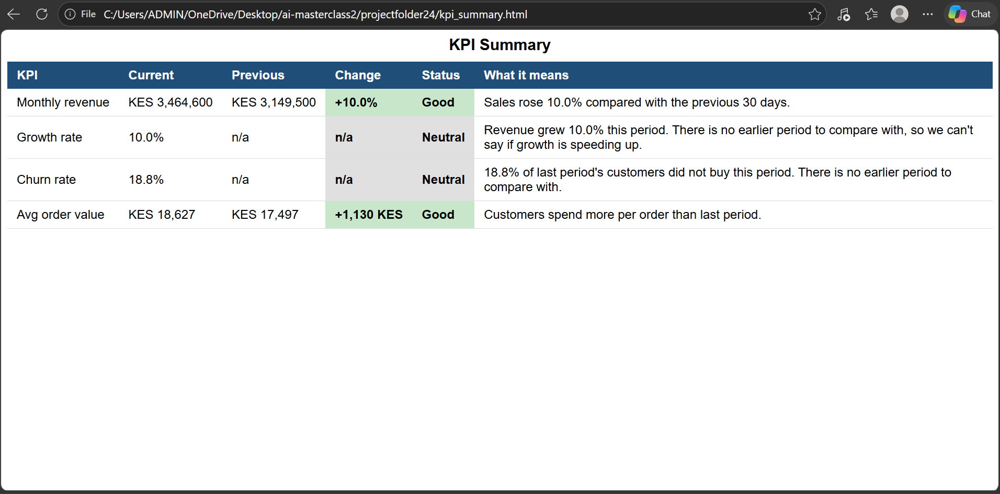

# Business KPI Summary: Heavy Vehicle Spares Shop

A Python script that turns raw sales records into a KPI summary table a business owner can read at a glance. Each KPI shows its current value, the previous period, the change, and a plain-language explanation.

> All data in this project is synthetic.



## KPI summary

Latest results (current period: 2026-10-20 to 2026-11-18, previous period: 2026-09-20 to 2026-10-19):

| KPI | Current | Previous | Change | What it means |
|---|---|---|---|---|
| Monthly revenue | KES 3,464,600 | KES 3,149,500 | +10.0% | Sales rose 10.0% compared with the previous 30 days. |
| Growth rate | 10.0% | n/a | n/a | Revenue grew 10.0% this period. There is no earlier period to compare with. |
| Churn rate | 18.8% | n/a | n/a | 18.8% of last period's customers did not buy this period. |
| Avg order value | KES 18,627 | KES 17,497 | +1,130 KES | Customers spend more per order than last period. |

The script shows "n/a" instead of a made-up numbe since there are only two full 30-day periods. Comparing growth and churn with an earlier period would need a third one.

## What's in this project

| File | Purpose |
|---|---|
| `inventory.csv` | Product list with unit prices |
| `kpi_summary_gen.py` | Calculates the KPIs and saves `kpi_summary.csv` |
| `sales_customers.csv` | Sales data with `customer_id` and `customer_name` (raw sales data) |
| `kpi_summary.csv` | The final KPI table (output)|

## How to run

```bash
pip install pandas
python kpi_summary.py     # prints the KPI table and creates kpi_summary.csv
```

Keep all the CSV files in the same folder as the scripts.

## How each KPI is calculated

- **Periods:** rolling 30-day windows ending on the last sales date (current, previous, earlier). Rolling windows were used instead of calendar months because the data starts mid-month.
- **Revenue:** quantity sold x unit price (KES), summed for the period.
- **Growth rate:** (this period's revenue - previous period's revenue) / previous period's revenue x 100.
- **Churn rate:** customers who bought in the previous period but not in the current one, divided by customers in the previous period, x 100.
- **Order:** all items one customer buys on one day.
- **Average order value:** revenue divided by the number of orders.
